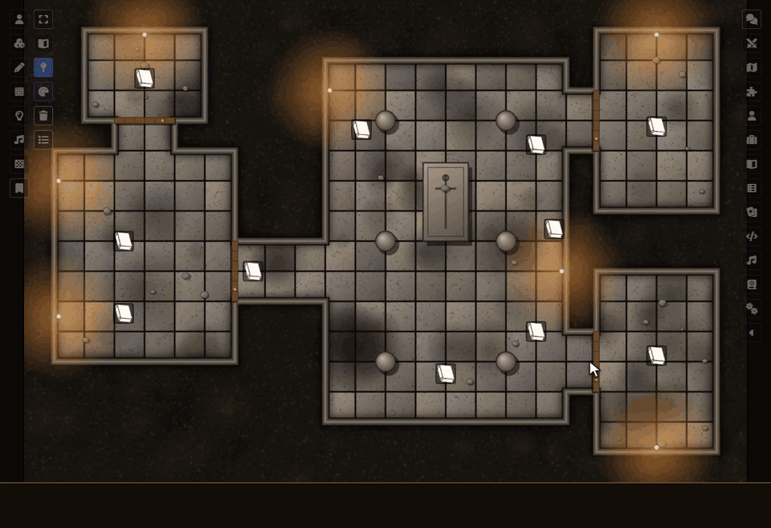

# Sephral’s Map Pins

**Pins on a big map you can finally read: names that stay visible, numbers that count up, a preview when you point at one, pins your players discover as they explore, quest marks, a keyed handout and travel routes.**

[](#install)
[](https://discord.gg/7BjCgDYaBP)
[](https://github.com/Sephral)



## Highlights

* **Pins you discover:** hide a pin until your players find it. It appears for each player when their characters explore its place, or when you reveal it for everyone or chosen players, with a short ping.
* **Quest marks:** a small mark shows a quest as open, done or failed, on the pin and in the list.
* **Map key:** one click makes a journal with a page per numbered pin in number order. Update it later and your own notes stay.
* **Routes and travel time:** pick pins in order on your overland map and see the distance in your scene's units and the time at a slow, normal or fast pace. Share the route with your players, it stops before the first pin they do not know yet.
* **Readable pins:** labels that stay visible, no dark box, and a size that holds as you zoom. Pins can fade out below a zoom you choose.
* **Numbers:** a clean badge with `12` or `B3`. New pins count up by themselves, and one click numbers a whole scene. A journal called `12. Hall` hands its number to its pin.
* **Categories:** quest, shop, danger or your own, each with a color ring and a symbol. Players can hide categories for themselves.
* **Preview on hover:** the title, the first picture and the first lines of the journal, only for those who may read them. Secrets never reach the card.
* **Pin list:** search and filter every pin of the scene. A click pans to it, a double click opens it.
* **Pins by players:** a player clicks the map and writes a name and a text. The GM confirms, or lets it through.
* **Scene links:** a double click on a pin switches to another scene.
* **Bring your old pins:** one button takes over the look another pin module left on your notes.

Everything works on normal Foundry notes. Switch the module off and your pins are still there.

## How it works

1. Enable the module.
2. Open a pin's note settings and look at the new section *Map Pins*, or click *Pin list* in the notes controls on the left.
3. Set the look for the whole world in the module settings, and change single pins when they need to differ.

## Install

Map Pins is not in Foundry's module search. Copy this link:

```text
https://github.com/Sephral/sephrals-map-pins/releases/latest/download/module.json
```

1. In Foundry's setup screen open **Add-on Modules** and click **Install Module**.
2. Paste the link into **Manifest URL** at the bottom of the window.
3. Click **Install**, then enable the module in your world.

On The Forge open the Bazaar, click **Install From Manifest** and paste the link.


Foundry VTT 13 and 14 · any game system · English and German

## Learn more

Every setting, the rights of the preview, what other players' browsers receive and the macro API are explained in the [manual](MANUAL.md). Questions or ideas? Join us on [Discord](https://discord.gg/7BjCgDYaBP). Looking for more? See [all modules by Sephral](https://github.com/Sephral).

## License

See [LICENSE.md](LICENSE.md).
